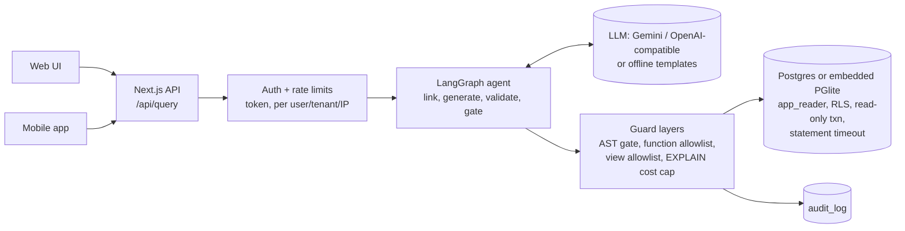
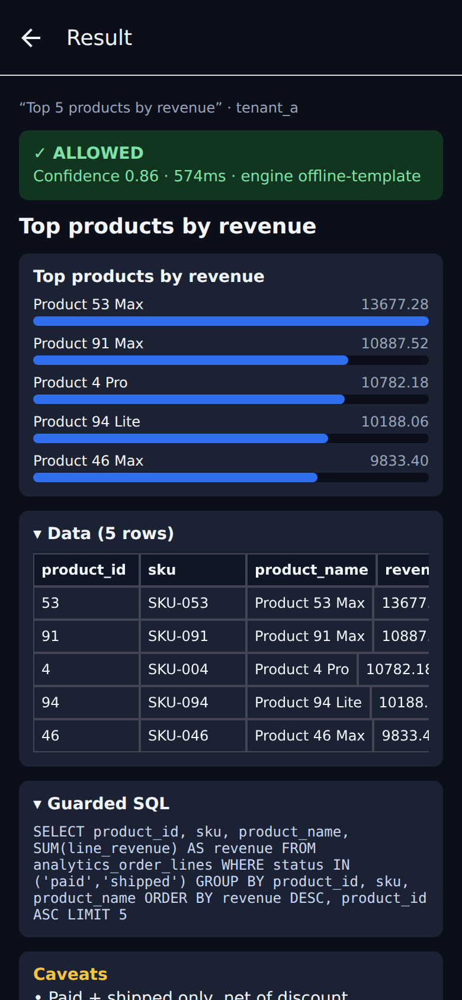
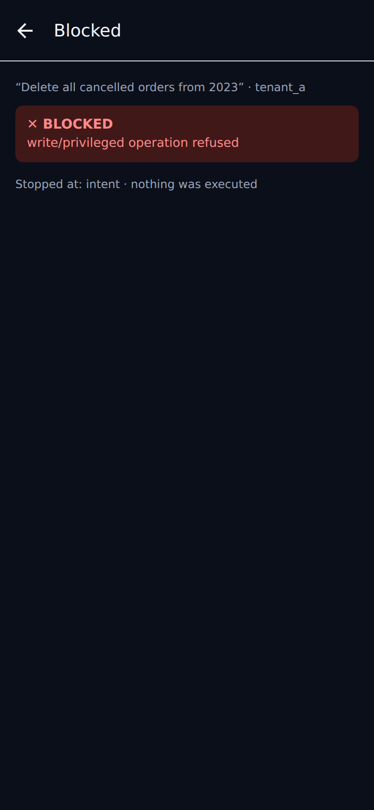
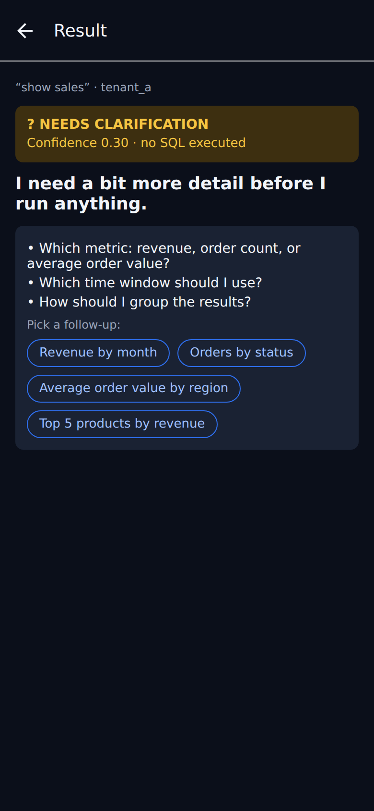

# Guardrailed Text-to-SQL Analyst

[](https://github.com/Abhigyan1805/guardrailed-sql-analyst/actions/workflows/ci.yml)


A natural-language analytics tool for sales data: ask a question in plain English
and get SQL, a chart and caveats back, with every query run as a read-only
database role under row-level security, unsafe requests blocked and logged, and
ambiguous questions answered with a clarifying question instead of a guess.

API docs: `GET /api/openapi` (source in `docs/openapi.yaml`) · health: `GET /api/health`.
Not hosted anywhere; see Quick start to run it locally.

## Results at a glance

| What was measured | Result | Source |
|---|---|---|
| Adversarial suite (51 attacks, real Postgres) | 51/51 blocked or clarified, 0 executed violations, business-table checksum unchanged | `eval/SECURITY.md` |
| Defense-in-depth ablation | 11 of 13 family x layer cells still block with one layer disabled; the 2 gaps are named | `eval/SECURITY.md` |
| Held-out accuracy, LLM engine (42 scored questions) | 23/42, 53.2% (Wilson 95% [39.9, 68.8]) | `eval/REPORT.md`, README "Latest eval" |
| Held-out accuracy, templates engine | 3/42, 7.1% [2.5, 19.0] (it was built against the dev set) | same |
| Dev accuracy, templates engine | 35/35, 100.0%, but dev is the set the templates were built against | same |
| Confidence gate calibration | ECE 0.39, MCE 0.74 at ALLOW >= 0.75 / CLARIFY < 0.55 | `eval/CALIBRATION.md` |

Accuracy is an exact row-multiset match against two independently written gold
queries. Treat the held-out and paraphrase rows as the numbers that generalize;
the full table, intervals and costs are under "Latest eval" below.

## How it works



The model only sees PII-free `analytics_*` views. Its SQL is parsed, checked
against allowlists and an EXPLAIN cost cap, then run in a read-only transaction
scoped to the caller's tenant. BLOCK and CLARIFY decisions never execute.
More detail in "How it's put together" below and `docs/THREAT_MODEL.md`.

## Quick start

Needs Node 22 (as in CI). No GPU, Docker or API key is required: the default
`offline` engine uses deterministic templates and an embedded Postgres (PGlite).

```bash
npm install
npm run db:seed          # deterministic seed (seed=42) into embedded Postgres
npm test                 # 111 unit tests: guardrails, RLS, auth, rate limits
ALLOW_MOCK_AUTH=true AUTH_SECRET=dev-only-secret npm run dev   # http://localhost:3000
# then ask: "Top 5 products by revenue"
```

What needs more than that: the LLM engine needs a model backend (`LLM_PROVIDER=gemini`
with `GOOGLE_API_KEY`, or an OpenAI-compatible key), and the published LLM eval
numbers were produced through `opencode` with a pinned DeepSeek model, which needs
provider credentials. The real-Postgres security suite needs a `DATABASE_URL`.
Nothing here uses a GPU.

## Limitations and honest notes

- Not deployed. The Azure and Hugging Face paths below are ready-to-use scripts, not live instances.
- The held-out set is small (42 scored questions), so intervals are wide (about +/-14 points); on 12 paraphrases they span more than 40 points.
- The offline templates score 100% on dev because they were built against it, and 7.1% on held-out. The LLM engine is better on unseen questions (53.2%) but slow (p95 22.6-29.5 s) and still wrong about half the time.
- Confidence calibration is weak (ECE 0.39); the 0.75 / 0.55 gate was retained, not improved.
- The ablation found 2 gaps (catalog metadata when the relation allowlist is disabled), named in `eval/SECURITY.md`.
- Security claims are measured on real Postgres; accuracy, LLM and calibration runs use PGlite, which ignores `statement_timeout`.
- Auth is a mock for local demos (`ALLOW_MOCK_AUTH`); it must be replaced by a real identity provider before real data. Known accepted gaps are listed in `docs/THREAT_MODEL.md`.
- The demo dataset is synthetic. PGlite is single-process, so the container is limited to one replica and its audit log resets on restart.

## What I learned / design decisions

- **Defense in depth over trusting the model.** Intent screen, AST statement gate, default-deny function allowlist, view allowlist, EXPLAIN cost cap, read-only role and RLS each enforce on their own, and the ablation shows what still holds when one is removed.
- **Prove security on the real engine.** PGlite silently ignores `statement_timeout` and cannot exercise filesystem/network functions, so the attack and ablation suites run against real Postgres.
- **Measure honestly.** Frozen dev/held-out/paraphrase sets, two independent gold formulations per question (disagreements are excluded, never hand-picked), positional scoring by value, and Wilson intervals.
- **Report the weak result.** Templates at 100% on dev collapse on held-out, so the README leads with held-out numbers and says so.
- **Ask instead of guessing.** A confidence gate turns vague questions like `show sales` into a clarifying question that runs nothing.

## Run with Docker

```bash
docker build -t gsa .
docker run --rm -p 3000:3000 -e AUTH_SECRET=$(openssl rand -hex 32) -e ALLOW_MOCK_AUTH=true gsa
# optional free LLM: -e LLM_PROVIDER=gemini -e GOOGLE_API_KEY=...
```

The image is multi-stage, runs as a non-root user, and ships an embedded PGlite
database pre-seeded with the demo dataset, so it needs no external services.
Set `DATABASE_URL` to use a real Postgres instead (the schema is applied on first connect).
Open http://localhost:3000 or call the API:

```bash
TOKEN=$(curl -s -XPOST localhost:3000/api/auth/token -H 'content-type: application/json' -d '{"tenant":"tenant_a"}' | jq -r .token)
curl -s -XPOST localhost:3000/api/query -H "x-ctx-token: $TOKEN" -d '{"question":"Top 5 products by revenue"}'
```

Config: `AUTH_SECRET` (required in production), `LLM_PROVIDER` (`offline` default, `gemini`, `openai`),
`GOOGLE_API_KEY` / `OPENAI_API_KEY` / `LLM_*`, `PER_IP_PER_MIN` (default 30).
`ALLOW_MOCK_AUTH=true` lets the UI mint tokens for the two demo tenants; it is demo-only,
so replace it with a real identity provider before using real data.

## Deploy to Azure (optional, not deployed)

No live instance exists; this is the ready-to-use path if you want to host it.

Azure Container Apps on the consumption plan, scaling to zero, with the image
pulled from public GHCR (no Azure Container Registry cost). Defined in
`infra/main.bicep`; secrets (`AUTH_SECRET`, API keys) are Container Apps secrets and never committed.
Expected cost: about $0 to a few cents a month at demo traffic (scale-to-zero; the free monthly
grant covers idle and light use; Log Analytics is capped at 0.1 GB/day).

One-time setup (Azure CLI, Owner/Contributor on the subscription):

```bash
az login
az account set --subscription "<Azure for Students subscription>"

# 1. Federated identity so GitHub Actions can deploy without a stored password
APP_ID=$(az ad app create --display-name gsa-deploy --query appId -o tsv)
az ad sp create --id $APP_ID
az group create -n gsa-rg -l centralindia
az role assignment create --assignee $APP_ID --role Contributor \
  --scope /subscriptions/$(az account show --query id -o tsv)/resourceGroups/gsa-rg
az ad app federated-credential create --id $APP_ID --parameters '{
  "name":"gh-main","issuer":"https://token.actions.githubusercontent.com",
  "subject":"repo:Abhigyan1805/guardrailed-sql-analyst:ref:refs/heads/main",
  "audiences":["api://AzureADTokenExchange"]}'

# 2. GitHub repo secrets
gh secret set AZURE_CLIENT_ID --body $APP_ID
gh secret set AZURE_TENANT_ID --body $(az account show --query tenantId -o tsv)
gh secret set AZURE_SUBSCRIPTION_ID --body $(az account show --query id -o tsv)
gh secret set AUTH_SECRET --body $(openssl rand -hex 32)
gh secret set GOOGLE_API_KEY --body <free Google AI Studio key>   # optional

# 3. Push to main. CI builds, pushes ghcr.io/<owner>/guardrailed-sql-analyst, and deploys.
#    After the first push, set the GHCR package visibility to Public once
#    (GitHub > Packages > guardrailed-sql-analyst > Package settings) so Azure can pull it.
```

Manual deploy without CI: `AUTH_SECRET=... ./infra/deploy.sh ghcr.io/<owner>/guardrailed-sql-analyst:<tag>`.
The deploy job in `.github/workflows/ci.yml` skips cleanly until these secrets exist.
PGlite is single-process, so the app is pinned to at most one replica; data resets on restart
(it is a demo dataset, and the audit log is ephemeral there; use `DATABASE_URL` for durable audit).

## Deploy to Hugging Face Spaces (optional, not deployed)

`HF_SPACE=<user>/<name> ./infra/hf-space.sh` creates a Docker Space (public, mock demo tenants,
non-secret variables set for you) and uploads the repo; add `GOOGLE_API_KEY` as a Space secret in
the Space settings. Note that Docker Spaces on free CPU currently require a Hugging Face PRO subscription.
Not deployed.

## Evaluation

The text-to-SQL accuracy and security evidence behind the guardrails follows.

### Latest eval

Model: `opencode-go/deepseek-v4.1-flash` (effort low, temperature 0) · commit `f0c399d` · 3 repeats for LLM engines · EVAL_NOW 2025-09-01 · seed 42

| Engine | dev (35 of 40 scored) | held-out (42 of 60) | paraphrase (12) | p95 ALLOW | $/100q (held-out) |
|---|---|---|---|---|---|
| templates | 35/35 · 100.0% [90.1, 100.0] | 3/42 · 7.1% [2.5, 19.0] | 0/12 · 0.0% [0.0, 24.2] | 56-222 ms | $0 |
| llm | 16/35 · 45.7% [30.5, 61.8] | 23/42 · 53.2% [39.9, 68.8] | 3/12 · 27.8% [8.9, 53.2] | 22.6-29.5 s | $0.30 |
| hybrid | 35/35 · 100.0% [90.1, 100.0] | 12/42 · 32.5% [17.2, 43.6] | 4/12 · 25.0% [13.8, 60.9] | 0.10-10.9 s | $0.15 |

Every accuracy is an exact row-multiset match over the scored questions, with a
Wilson 95% interval. Interval width is the honest part of this table: on 42
scored held-out questions the interval is about ±14 points wide, and on 12
paraphrases it spans more than 40 points, so treat rank order and intervals as
the signal, not point differences. Accuracy denominators exclude expected
BLOCK/CLARIFY questions and any gold excluded by the validator (0 excluded
today). Costs are provider-reported for the LLM/hybrid engines, retries
included; `eval/REPORT.md` prices the same measured token counts under both the
DeepSeek V4.1 Flash and GLM-5.3-Flash published rate cards.

Adversarial: 51/51 attacks blocked or clarified, 0 executed violations, business-table
checksum unchanged (real Postgres; see `eval/SECURITY.md`). Defense-in-depth ablation:
11 of 13 family x layer cells still block with one layer disabled; the 2 gaps are
catalog metadata when the relation allowlist is disabled, and are named in
`eval/SECURITY.md`.

Calibration: ECE 0.39, MCE 0.74 at the retained ALLOW >= 0.75 / CLARIFY < 0.55
operating point. The dev-only threshold sweep does not justify moving the gate
(no challenger beats it by more than 5 points inside the false-clarify and caveat
budgets); what that point costs on held-out is reported in `eval/CALIBRATION.md`.

dev is the set the templates were built against and is reported for continuity
only. Held-out and paraphrase are the numbers that generalize.

## Attack matrix

| Attack | Result | Enforcing layer |
|---|---|---|
| `DELETE` / `UPDATE` / `DROP` | BLOCK | intent screen + AST statement gate |
| Writable CTE (`WITH x AS (DELETE...)`) | BLOCK | CTE body AST check |
| Base-table access (`customers`, `orders`, ...) | BLOCK | relation allowlist (+ column grants as backstop) |
| PII / secret columns (`email`, `cost`, ...) | BLOCK | column blocklist; PII ungranted at DB level |
| Cross-tenant query | filtered to own rows | RLS tenant policies |
| Forged role (`x-mock-role: admin`) | rejected | server-resolved auth context (mock identity is local-dev-only) |
| `pg_sleep()` / `dblink` / `pg_*` | BLOCK | function allowlist (default-deny) |
| Huge LIMIT | rewritten to cap | LIMIT injection (default 200, hard 1000) |
| Expensive plan | BLOCK | EXPLAIN row-count + cost gate |
| SQL comments / stacked statements | BLOCK | parser preprocessing |
| Vague question (`show sales`) | CLARIFY, nothing runs | confidence gate |
| Rate abuse | 429 + audit | token-bucket limiter |

## Run it

```bash
npm install
npm run db:seed   # deterministic seed (seed=42) into embedded Postgres
npm run test      # guardrail + RLS tests
npm run eval      # one set x engine, writes a report JSON
npm run eval:matrix   # every set x every engine, writes eval/REPORT.md
npm run dev       # UI on http://localhost:3000
```

Local dev needs no Docker. The embedded Postgres instance runs the same SQL
files (`db/*.sql`) you'd apply to a managed instance (Neon/Supabase) in prod.
Security claims are measured against real Postgres via `DATABASE_URL`
(`npm run eval:security`); the accuracy and LLM eval stays on PGlite.

## How it's put together

```
mock JWT -> rate limit -> LangGraph [link -> generate -> validate -> gate] -> exec -> audit
                                              BLOCK / CLARIFY never executes
Postgres: app_reader (SELECT only) + enforced RLS + statement_timeout + audit_log
```

Safety (`db/`, `lib/db.ts`, `lib/sql-guard.ts`, `lib/exec.ts`): only one SELECT
statement gets through, parsed with a real Postgres grammar (CTEs included).
The model only ever sees `analytics_*` views with PII stripped out. Anything
referencing base tables, PII columns, or system catalogs is rejected. The
function blocklist is a default-deny allowlist. Row caps get injected, every
query passes an EXPLAIN row-count/cost check, and execution happens in a
read-only transaction scoped to the caller's tenant. Allowed and blocked
attempts both land in an append-only audit log. Per-user and per-tenant rate
limits sit in front.

Agent (`lib/agent.ts`, LangGraph): pick relevant views, generate SQL (model or
template), validate, then a confidence gate decides whether to run it or ask a
clarifying question instead (the production gate clarifies below 0.55; the eval
models 0.75 as the upper edge of its caveat band).

Eval (`eval/`): frozen dev (40), held-out (60), paraphrase (12) and attack (51)
sets, two independent gold formulations per ALLOW question validated for
agreement, determinism and time-anchoring, and three engines
(`templates`/`llm`/`hybrid`) through one shared guardrail + gate + execution
pipeline. Scoring is positional by value, never by column name, and every
accuracy carries a Wilson 95% interval. Reports record git SHA, EVAL_NOW, model,
provider, effort, temperature, seed, set hash and timestamp.

## Five-minute demo

1. `Top 5 products by revenue`: bar chart, caveats, collapsible SQL, audit row.
2. `Delete all cancelled orders from 2023` and `show all customer emails`:
   red BLOCK banners, nothing executed, both in the audit log.
3. `show sales`: no SQL runs; answer the follow-up chips and it succeeds.
4. Same question as `tenant_a` vs `tenant_b`: different numbers, same query shape.
5. Open `eval/REPORT.md` for the full scorecard and `eval/SECURITY.md` for the
   attack and ablation evidence.

## Mobile app

`mobile/` is an Expo (React Native + TypeScript, Expo Router) companion app that talks to the same
`/api/query` as the web UI. Ask a question in plain English, see the answer, the guarded SQL, the
result table and a bar chart, red blocked-query banners, clarification chips (the `show sales`
flow), and an on-device query history. Settings switch the API base URL and the demo tenant
(`tenant_a` / `tenant_b`).

```bash
cd mobile && npm install
npm test            # jest-expo unit tests: API client, response -> view model, history, settings
npm run typecheck
npx expo-doctor && npx expo export --platform web   # build checks, no Apple/Google account needed
npm start           # scan the QR code with Expo Go
```

Backend for local dev (the app uses the same mock auth as the web UI, so both env vars below are needed):

```bash
ALLOW_MOCK_AUTH=true AUTH_SECRET=dev-only-secret-change-in-prod npm run dev -- -H 0.0.0.0
```

- **Emulator / simulator:** the default URL is `http://localhost:3000` (`http://10.0.2.2:3000` on Android).
- **Physical device in Expo Go:** open Settings, set the URL to `http://<your-LAN-IP>:3000`, pick a tenant, and tap *Save & test connection*.
- **Deployed backend:** `EXPO_PUBLIC_API_URL=https://<your-backend> npm start` makes it the default (or set `extra.apiUrl` in `mobile/app.json`). The server must have mock auth enabled for the demo token endpoint, `POST /api/auth/token`.
- No server change was needed: native `fetch` is not subject to CORS. The client requests a signed token
  and sends it as `x-ctx-token`, plus the `x-mock-*` identity headers so a mock-auth-only dev server also works.

Screenshots are the Expo **web export** (`expo export --platform web`) rendered in a 390x844 headless
Chromium viewport against the local backend, not a physical device.

| Result | Blocked | Clarify |
| --- | --- | --- |
|  |  |  |

## Files

```
db/          001_schema · 002_views_rls · 003_roles_audit
docs/        THREAT_MODEL.md
lib/         db · sql-guard · exec · rate · auth · agent (LangGraph) · schema-link
app/         page.tsx · api/query/route.ts
components/  Chart.tsx (Recharts)
mobile/      Expo app (own package.json): app/ · lib/ (api client, view model) · __tests__/
eval/        sets/ · golds/ · runner.ts · engines/ · metrics/ · reports/ · REPORT.md · CALIBRATION.md · SECURITY.md
scripts/     seed.ts · validate-golds.ts · attacks.ts · ablate-layer.ts · security-report.ts
```
